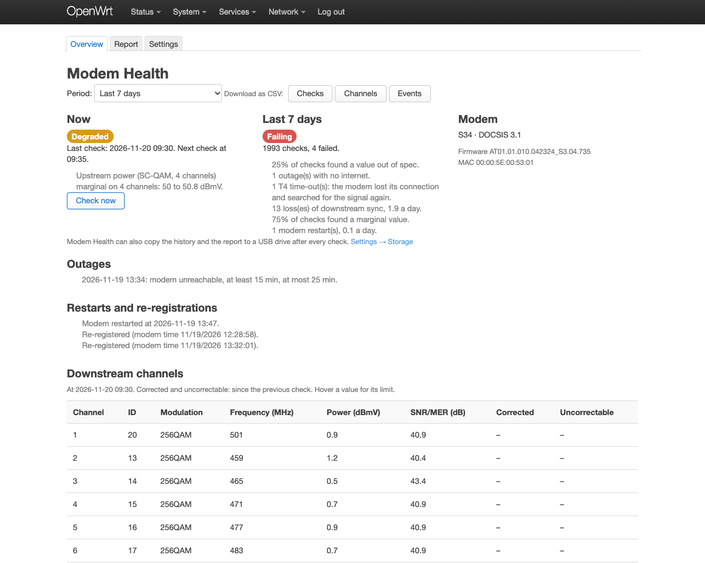
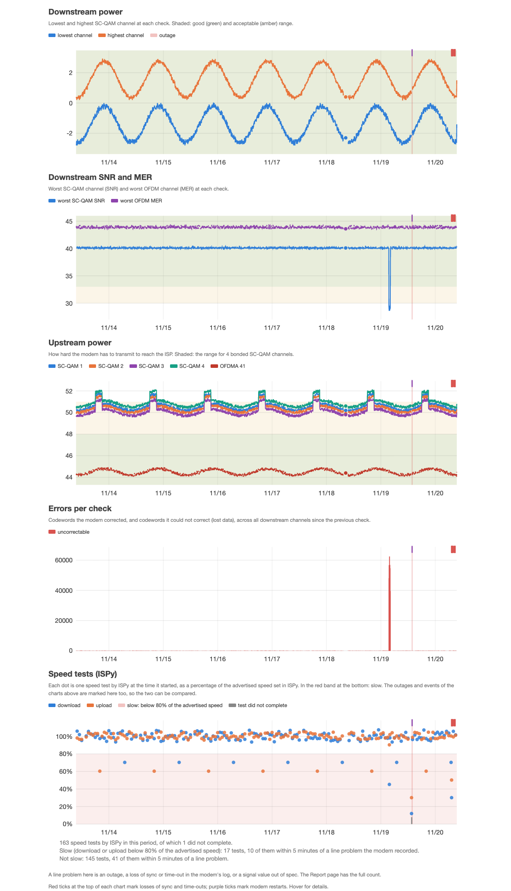
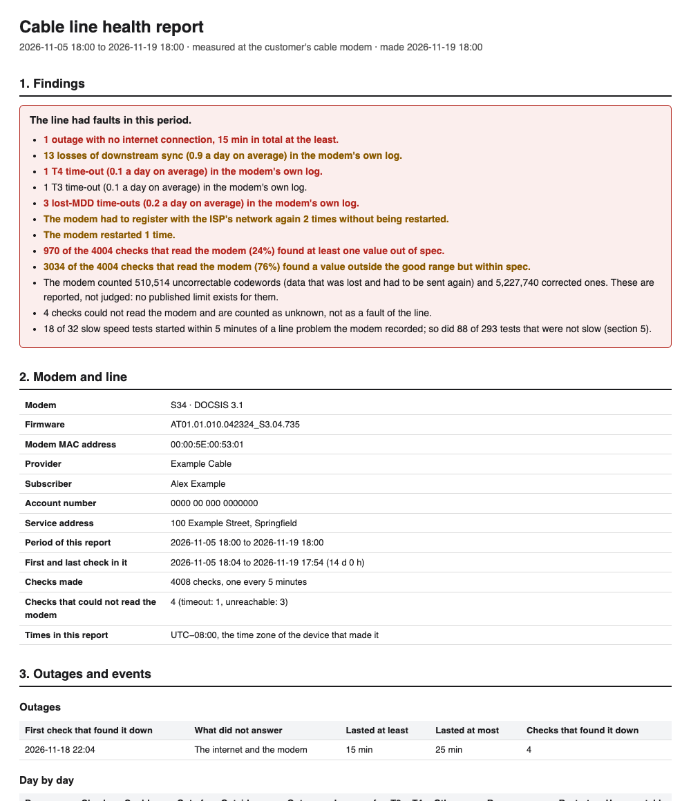
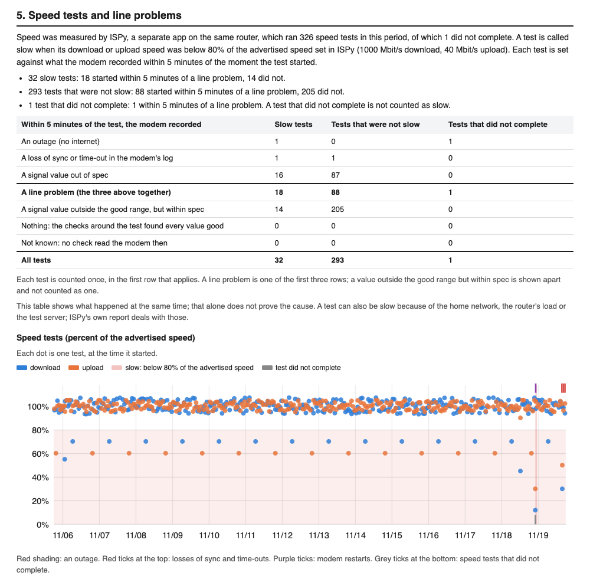

# Modem Health

**Modem Health** is an app for OpenWrt and GL.iNet routers that watches your
cable modem. Every few minutes the router logs in to the modem, reads its
signal levels, error counts and event log, and keeps them. It shows whether
the line is healthy, and builds a **printable report** for your provider's
support or a technician: when the line dropped, which values were out of
spec, and against which published limits.

It runs in LuCI (**Services → Modem Health**) and, on GL.iNet routers, in
GL's own admin panel (**Applications → Modem Health**). It was built on a
GL.iNet GL-BE9300 (Flint 3) behind an ARRIS SURFboard S34.


<sub>The Overview in LuCI, with a week of demo data.</sub>

## What it does

- **Checks the modem around the clock**, every 5 minutes by default, and
  keeps 90 days of history on the router.
- **Judges every channel** against DOCSIS limits and manufacturers'
  guidance: downstream power and SNR/MER, upstream power, and whether each
  channel is locked. Every limit names its source, and you can change it.
- **Keeps the modem's event log.** The modem only remembers its last 100
  entries, which on a bad line is a couple of hours. The router copies new
  entries at every check, so losses of sync, T3/T4 time-outs and
  re-registrations are still there weeks later.
- **Finds outages and restarts.** At every check it pings the modem and a
  host on the internet, which tells "the line is down" from "the modem is
  off", and it notices when the modem has restarted.
- **Counts lost data.** Corrected and uncorrectable codewords are stored as
  the change since the previous check.
- **Stores failures honestly.** A check that could not read the modem is
  stored as *failed* with its reason, never as a healthy or empty reading.
- **Report for your provider** (see below), on the page, as a PDF, or as one
  HTML file.
- **Copy on a USB drive**: the history as CSV files and the report as a file
  that opens in any browser, without the router.
- **Works with [ISPy](https://github.com/chaffed/luci-app-ispy)**: if ISPy
  runs speed tests on the same router, Modem Health shows them next to the
  line's problems and counts how many slow tests fell on one.


<sub>The charts share one time axis. Red shading is an outage; ticks at the
top are losses of sync, time-outs and modem restarts.</sub>

## Supported modems

| Modem | Status |
|---|---|
| ARRIS / Vantiva SURFboard **S34** | Works. Developed and tested on one (firmware `AT01.01.010.042324_S3.04.735`). |
| ARRIS / Vantiva SURFboard **S33** | Should work: it shares the S34's firmware family and login. Not yet tested on a real one. |
| Anything else | Not supported yet. **Test connection** in Settings says so. See [Helping add another modem](#helping-add-another-modem). |

The modem has to be a plain cable modem with the router behind it (not a
combined modem-router), and the router has to reach the modem's own web page.
SURFboards answer at `192.168.100.1` through the router's WAN port without
any extra setup.

## The report

**Report** builds a document from the stored history that you can print, save
as a PDF, or download as one HTML file with no scripts and no outside files.


<sub>Sample built from demo data. Full sample: [docs/sample-report.pdf](docs/sample-report.pdf).</sub>

It contains:

1. **Findings**: a plain statement of what was found. If nothing was wrong,
   it says "No problems found" and how many checks that rests on.
2. **Modem and line**: model, firmware, MAC address, your account details,
   the period, and how many checks were made.
3. **Outages and events**: every outage with the shortest and longest time
   it can have lasted, a day-by-day table, and every loss of sync, time-out,
   re-registration and restart with its time.
4. **Signal**: the lowest and highest value seen against its limit, the
   channels with the most trouble, and charts.
5. **Speed tests and line problems**, when ISPy is installed (see below).
6. **How this was measured**: the limits with their sources, what the router
   can and cannot see, and where doubt was resolved in the provider's favour.

The report is cautious on purpose, because it is meant to be believed:

- A check that could not read the modem counts as unknown, never as a fault.
- An outage is said to have lasted *at least* what the checks prove.
- Uncorrectable errors are reported but not judged, because no published
  limit exists for them.
- With less than three days of checks the report calls itself *preliminary*.

### Using it with your provider

1. **Let it run.** Three days is the minimum; a week or two shows whether
   the trouble follows the time of day.
2. **Add your details** under **Settings → Report details** (provider, name
   on the account, account number, service address), so the provider can
   match the report to your account.
3. **Check your own side first.** Tighten the coax connectors by hand and
   take out any splitter you don't need. If the values improve, you have
   found it; if they don't, you can say you checked.
4. **Write your statement** in the box on the Report page: when it started,
   when you called, any ticket numbers. It is printed under "Subscriber's
   statement".
5. **Send the PDF** to your provider's support, ask for a ticket number and
   for a technician to look at the line. The page that matters to a
   technician is section 4: levels out of range, and on which channels.

The report states measurements taken by your own equipment. It cannot tell
whether a fault is in your home or in the street, and it is not legal advice.

### Speed tests from ISPy

Modem Health does not measure speed. If
[ISPy](https://github.com/chaffed/luci-app-ispy) is installed on the same
router, Modem Health reads ISPy's results and sets each speed test against
what the modem recorded within one check interval of it: an outage, a loss
of sync or time-out, or a signal value out of spec.



A test is slow by ISPy's own rule: below 80% of the advertised speed you
entered in ISPy. The report counts slow tests that fell on a line problem,
slow tests that did not, and the same for the tests that were not slow, so
the two can be compared. It says plainly that two things happening together
do not prove that one caused the other. Nothing needs setting up, and
without ISPy nothing about speed is shown.

## Install

### 1. LuCI on GL.iNet firmware

GL.iNet firmware has its own web interface; LuCI is an add-on. In the GL
admin panel open **System → Advanced Settings** and install LuCI, or run
over SSH what that button runs:

```sh
sh /usr/bin/init_luci.sh web
```

LuCI is then at `http://192.168.8.1:8080/cgi-bin/luci` (the GL panel stays on
port 80). On stock OpenWrt, LuCI is normally there already.

### 2. Install Modem Health

Download `luci-app-modemhealth_*_all.ipk` from
[Releases](https://github.com/chaffed/luci-app-modemhealth/releases), then:

```sh
scp -O luci-app-modemhealth_*_all.ipk root@192.168.8.1:/tmp/
ssh root@192.168.8.1 'opkg update && opkg install /tmp/luci-app-modemhealth_*_all.ipk'
```

(`-O` makes `scp` use the older protocol; OpenWrt has no SFTP server by
default. On stock OpenWrt the router is usually `192.168.1.1`.)

The package is the same for every router (shell and JavaScript). It needs
`luci-base`, `curl`, `jsonfilter` and `openssl-util`, which `opkg` installs
with it.

### 3. Give it the modem's password

Open **Modem Health → Settings**:

1. Enter the password you use for the modem's own web page
   (`https://192.168.100.1`). Newer SURFboards make you choose one the first
   time you log in there.
2. Press **Test connection**. It should answer with the modem's model,
   firmware and number of channels.
3. Save. The first check runs within a few minutes, and the Overview fills
   in from there.

Until a password is saved, the Overview says so, and each check is stored as
failed with the reason "no password".

### In the GL.iNet admin panel

On GL.iNet firmware 4.x Modem Health adds itself to GL's admin panel
(`http://192.168.8.1`) under **Applications → Modem Health**, with the same
Overview, Report and Settings and your usual panel login. Checked on a
GL-BE9300 with firmware 4.10.1.

GL.iNet does not document how apps plug into its panel, so a later firmware
could change it. LuCI keeps working either way.

## Settings

| Setting | Default | What it does |
|---|---|---|
| Modem address | `192.168.100.1` | Where the modem's web page is. |
| User name, password | `admin`, none | The modem's own login. |
| Check the modem on a schedule | on | Turn the checks off without removing the app. |
| Check every | 5 minutes | 1 to 15 minutes. More than 15 risks losing log entries on a bad line. |
| Internet host to ping | `1.1.1.1` | Pinged at every check to find outages. |
| Keep history for | 90 days | About 4–8 MB at 5-minute checks. |
| Copy to a USB drive | off | A folder on an attached drive (see below). |
| Report details | empty | Provider, name, account number and address, printed on the report. |
| Health limits | sourced defaults | See below. |

**Clear history** in Settings deletes everything stored on the router. A copy
on a USB drive is kept under a dated name.

### The limits, and where they come from

| Value | Good | Acceptable | Source |
|---|---|---|---|
| Downstream power (SC-QAM, OFDM) | −7 to +7 dBmV | −15 to +15 dBmV | DOCSIS 3.0 / 3.1 PHY; ARRIS and NETGEAR guidance |
| Downstream SNR (256-QAM) | 33 dB or more | 30 dB or more | DOCSIS 3.0 PHY (30 dB minimum); the 3 dB margin is Modem Health's |
| Downstream MER (OFDM) | 41 dB or more | 34 dB or more | DOCSIS 3.1 PHY |
| Upstream power (SC-QAM) | 38 to 48 dBmV | 23 to 51–57 dBmV, by number of channels | DOCSIS 3.0 PHY; ARRIS and NETGEAR guidance |
| Upstream power (OFDMA) | up to 48 dBmV | up to 65 dBmV | DOCSIS 3.1 PHY; Modem Health's judgement |
| T3 time-outs | 1 a day | 5 a day | Cisco troubleshooting guide; Modem Health's judgement |
| T4 time-outs, outages | none | none | Modem Health's judgement |
| Losses of sync | none | 2 a day | Modem Health's judgement |
| Modem restarts | none | 1 a day | Modem Health's judgement |

No provider publishes official signal thresholds. The table often quoted
online as "the Xfinity table" is a volunteer's forum post, and Modem Health
does not cite it. Where no published limit exists, the threshold is marked as
Modem Health's own judgement, on the Settings page and in the report.

You can change any limit in **Settings → Health limits**. A changed limit is
marked as yours in the Overview and the report, which then no longer cite
the default's sources for it.

## Copy on a USB drive

Plug a drive into the router and choose a folder under **Settings → Storage
→ Copy to a USB drive**; the page lists the drives it finds (on GL.iNet
firmware a drive appears as `/tmp/mountd/disk1_part1`).

| File | What it is |
|---|---|
| `modemhealth-readings.csv` | one row per check, failed checks included |
| `modemhealth-channels.csv` | one row per channel per check |
| `modemhealth-events.csv` | the modem's log entries |
| `modemhealth-lineup.csv` | each channel's frequency and modulation, when they changed |
| `modemhealth-outages.csv` | the outages |
| `modemhealth-report.html` | the report as one file, with the last 30 days |

- **After every check** only the new rows are added to the CSV files. The
  report file is larger, so it is written once a day, and when you press
  **Save to the drive now** on the Overview.
- **`modemhealth-report.html` needs neither the router nor a network.** Open
  it in any browser, choose the period, add your statement, print.
- **The router keeps its own copy.** While the drive is unplugged the copy is
  skipped and the Overview says so. Nothing is written anywhere else, and the
  next check after the drive is back catches up.
- **The drive keeps more than the router.** Days the router has dropped after
  90 days stay in the CSV files on the drive.
- The report file holds your report details (name, address, account number),
  so treat the drive accordingly.

## Privacy

- **The modem password** is stored in `/etc/config/modemhealth_auth`,
  readable by root only. It is never sent back to the browser, never written
  to the history, the log, the report or the USB drive.
- **Everything stays on the router** and on the drive you plug in. Modem
  Health sends nothing anywhere. Its only traffic is the login to your modem
  and three pings to the host you chose.
- **What is stored**: signal values, error counts, the modem's log, and the
  modem's model, firmware and MAC address (the provider needs the MAC
  address to find your line). Public IP addresses in the modem's log are not
  stored.
- **Your report details** are stored in the router's settings and printed on
  the report, which is what they are for.

## Good to know

- **The modem's log notes every login.** Modem Health keeps one session
  between checks instead of logging in each time, so the modem's 100-entry
  log is not filled with its own logins. A new login happens when the
  session ends: after a router restart, or after 10–15 minutes without a
  check.
- **Modem Health only reads.** It never restarts the modem or changes
  anything on it.
- **The router's clock.** After a restart the checks wait until the clock is
  set from the internet, so every reading has the right time.
- **History survives** reboots and firmware upgrades that keep settings. It
  is in `/etc/modemhealth/`.
- **Times** on the pages are your browser's local time. Times in a report
  are in the time zone of the device that made it, which the report states.

## Troubleshooting

| What you see | What it means |
|---|---|
| "Something answered at this address, but it is not a supported modem" or "The modem answered 'not found'" | The modem is not an S33 or S34. See [Helping add another modem](#helping-add-another-modem). |
| "The modem refused the user name or password" | Log in at `https://192.168.100.1` in a browser to check them. The user name is usually `admin`. |
| "The modem did not answer at this address" | The router cannot reach the modem's web page. Check that `https://192.168.100.1` opens from a computer behind the router. A VPN or a second WAN on the router can get in the way. |
| "Modem Health needs your modem's password" | None is saved yet: Settings. |
| "Waiting for the router's clock to be set" | The router has just started and has no internet time yet. Checks begin when it has. |
| Checks stored as failed: `timeout`, `unreachable` | The modem did not answer in time. During an outage this is expected; the pings tell whether the internet was gone too. |
| "No drive is connected at …" | The USB folder is not on a mounted drive. Nothing is lost; replug the drive or choose another folder. |
| No **Modem Health** entry in the GL panel | Log out of the panel and in again. If it is still missing: `ssh root@192.168.8.1 /usr/sbin/nginx -s reload`. |

Messages go to the system log: `logread -e modemhealth`.

## Helping add another modem

Other SURFboard models (and other makes) report the same kind of values in
other formats. To add one, its replies are needed. `tools/capture.py` saves
them, on any computer with Python 3 that is connected behind the router:

```sh
python3 tools/capture.py            # asks for the modem's password, which is not saved
```

It writes a folder `modem-capture/` and a `modem-capture.zip`. On a modem
with the S33/S34's kind of login it saves the reply of each status page. On
any other modem it saves the status pages the modem shows without a login.

**What identifies you is replaced before anything is saved**: MAC addresses,
the serial number and public IP addresses, each with a reserved
documentation value such as `00:00:5E:00:53:01` or `203.0.113.1`. The tool
prints how many of each it replaced. Left in, because support for a model
needs them: channel frequencies, signal values, the event log, the firmware
version and the provider's configuration file name.

Please look through the files yourself all the same, then open an
[issue](https://github.com/chaffed/luci-app-modemhealth/issues) with the
modem's model and attach the zip. (`--raw` saves everything unchanged; never
share that.)

## Command line

```text
modemhealth check      # read the modem now and store the reading
modemhealth last       # the latest stored reading
modemhealth history 12 # the last 12 readings
modemhealth status     # scheduler state and modem identity, as JSON
modemhealth export     # save the history and the report to the USB drive now
modemhealth clear      # delete the history (the copy on a drive is kept)
```

## Files

| Piece | Path |
|---|---|
| Modem reader, storage and scheduler | `/usr/bin/modemhealth` (POSIX shell, busybox-compatible) |
| Service | `/etc/init.d/modemhealth` (procd) |
| Settings; modem password | `/etc/config/modemhealth`; `/etc/config/modemhealth_auth` (root only) |
| History | `/etc/modemhealth/` (daily CSV files; days before today are gzipped) |
| LuCI ↔ router | `/usr/libexec/rpcd/luci.modemhealth` (ubus `luci.modemhealth`) |
| Health rules, with every limit and its source | `/www/luci-static/resources/modemhealth/health.js` |
| Loading, charts; the report | `/www/luci-static/resources/modemhealth/common.js`; `report.js` |
| Pages | `/www/luci-static/resources/view/modemhealth/{overview,report,settings}.js` |
| Report file on a drive | `/usr/share/modemhealth/standalone.{html,js}` |
| GL.iNet admin panel | `/www/views/gl-sdk4-ui-modemhealth.common.js`, `/www/luci-static/resources/modemhealth/gl.js`, `/usr/lib/oui-httpd/rpc/modemhealth`, `/usr/share/oui/menu.d/modemhealth.json` |

## Development

```sh
node tests/health.test.js      # the health rules
node tests/ui.test.js          # loading and analysis behind the pages
node tests/report.test.js      # the report, statement by statement
node tests/settings.test.js    # every setting is in both forms and the panel's module
python3 tests/capture.test.py  # what tools/capture.py removes before saving
python3 tests/backend.test.py  # the real backend in an OpenWrt container against a fake modem (Docker)
sh tests/install.test.sh       # the .ipk: install, upgrade, remove (Docker)
node tests/luci.test.js        # the pages in a real LuCI, driven by Chrome (Docker, playwright-core)
node tests/gl.test.js          # the same in a stand-in for the GL panel
scripts/build-ipk.sh           # -> dist/luci-app-modemhealth_<version>_all.ipk (Linux or macOS)
```

`tests/fake_modem.py` replays a real S34's replies (`tests/fixtures/s34/`,
identifiers replaced) and checks every signature the way the modem does.
`node tests/screenshots.js` and `node tests/sample-report.js` rebuild the
pictures and the sample report in `docs/` from generated data.

`luci-app-modemhealth/` can also go into an OpenWrt/LuCI feed and be built
with the SDK. Tagging `vX.Y.Z` makes GitHub Actions attach the `.ipk` to a
release.

## Uninstall

```sh
opkg remove luci-app-modemhealth
```

Settings, the saved password and the history stay on the router, so
installing again picks up where it left off. To delete them too:

```sh
rm -r /etc/modemhealth /etc/config/modemhealth /etc/config/modemhealth_auth
```

## License

MIT
